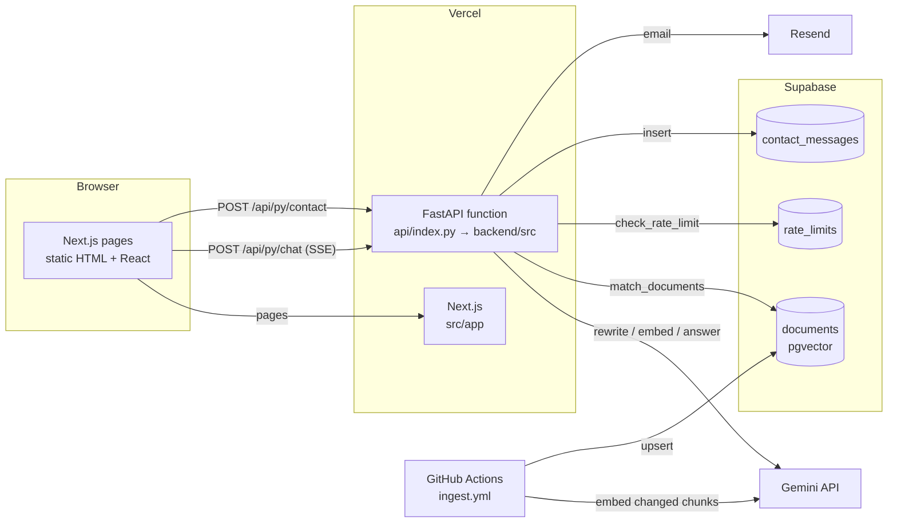

# Architecture

One repository, one Vercel project, two runtimes:

- **Next.js 16 (TypeScript, App Router)** renders every page. Pages are static: they're built from files in `content/` at deploy time, so they load fast and cost nothing to serve.
- **FastAPI + LangGraph (Python 3.12)** runs as a Vercel Python function at `/api/py/*`. It powers the "Ask my portfolio" chat and the contact form.
- **Supabase Postgres + pgvector** stores the RAG index, contact messages and rate-limit counters.
- **Google Gemini** rewrites queries, embeds text and writes answers. **Resend** emails contact-form messages.



## Request lifecycle: a chat question
1. The visitor types a question. `src/components/chat/useChat.ts` POSTs `{message, history}` to `/api/py/chat`. History is the last ≤10 exchanges; the server keeps no session state.
2. Vercel routes `/api/py/*` to the Python function (`next.config.ts` rewrite → `api/index.py`).
3. `routes/chat.py` validates the body and checks the per-IP rate limit (`core/rate_limit.py` → `check_rate_limit` RPC).
4. The LangGraph graph runs (see [agent-graph.md](agent-graph.md)): `compile_history → rewrite_query → (retrieve) → respond`.
5. Nodes push progress through LangGraph's custom stream: `status` events, then `token` events while Gemini streams the answer, then a `sources` event listing only the passages the answer cited.
6. The route forwards each one as a Server-Sent Event; the browser renders tokens as they arrive and fills the sources panel.

## Request lifecycle: a content edit
1. You edit `content/projects/plantatio.mdx` and push to `main`.
2. **Vercel** rebuilds the site. `src/lib/content.ts` validates every file against `src/lib/schemas.ts`; a bad field fails the build, so a broken page never ships.
3. **GitHub Actions** (`.github/workflows/ingest.yml`) runs `backend/scripts/ingest.py`, which re-embeds only the chunks whose content changed and deletes chunks for removed content. The chatbot knows about your edit within a minute or two.

## Folder map
```
content/                 Everything you edit: site.yaml, home.yaml, *.yaml, projects/*.mdx
knowledge/               Extra facts for the chatbot only (never rendered)
public/                  Images, CV PDF
src/
  app/                   Routes: / · /projects · /projects/[slug] · sitemap · robots · OG image
  components/
    sections/            One component per homepage section + registry.tsx (id → component)
    projects/ chat/ contact/ layout/ mdx/ ui/
  lib/                   schemas.ts (zod) · content.ts (loaders) · api.ts (backend client) · todo.ts
api/index.py             Vercel entrypoint → backend/src/agent/main.py
backend/
  src/agent/             FastAPI app, routes, LangGraph graph + nodes
  src/core/              settings, logging, Supabase client, rate limiting
  src/llm/               Gemini wrapper (generate, JSON, stream, embed)
  src/rag/               loaders, chunker, embedder, retriever, sync planner
  src/prompts/           system.md · rewrite.md · summarize.md  ← tune the chatbot here
  src/schemas/           prompt_rewriter.schema.json
  scripts/ingest.py      Builds/refreshes the RAG index
  tests/unit · tests/evals
supabase/migrations/     SQL schema (pgvector, RPCs, RLS)
deploy/home_server/      Optional Docker self-hosting of the API
docs/                    You are here
```

## Why these technologies
| Choice | Reason |
|---|---|
| Next.js static generation | Pages are pure content; static HTML is fastest and free to host. Typed React components keep sections modular. |
| FastAPI + LangGraph in Python | The agent is the showcase of Reuben's Python/LangGraph skills; FastAPI streams SSE natively. See [ADR 0002](decisions/0002-python-backend-typescript-frontend.md). |
| Supabase pgvector | One managed Postgres for vectors, contact messages and rate limits, with a free tier. See [ADR 0003](decisions/0003-pgvector.md). |
| Gemini | Fast Flash models for answering, Flash-Lite for the cheap rewriter step, and `gemini-embedding-001` for retrieval. Model ids are env vars. |
| Files as the CMS | Content is versioned in git, reviewed in PRs, validated at build time, and indexed for RAG automatically. See [ADR 0004](decisions/0004-file-based-content.md). |
