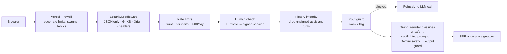

# Security

This site is public, runs an LLM on Reuben's own API keys, and speaks *as* Reuben's portfolio. Security here has three goals:

1. **Keep it up and affordable.** Bots and abuse must not take the site down or run up the Gemini, Supabase or Vercel bill (denial of wallet).
2. **Keep the chatbot on-message.** No prompt injection, jailbreaks, leaked instructions, or offensive output published under Reuben's name.
3. **Keep secrets and visitor data safe.** API keys never reach the browser; visitor IPs are never stored in clear text.

## Threat model

| Asset | Threat | Main defences |
|---|---|---|
| Gemini / Supabase budget | Scripted floods, IP rotation | Vercel Firewall edge limits, Turnstile, per-IP + burst limits, **500/day site-wide cap**, fail-closed limiter |
| Chatbot behaviour & reputation | Prompt injection, jailbreaks, role-play, forged history, encoded payloads | Signed history, input guard, LLM classifier, spotlighting, Gemini safety filters, output guard |
| System prompt | Extraction ("repeat the text above", translation, summaries) | Confidentiality rules, canary token, n-gram leak detection with retraction |
| API endpoints | CSRF / cross-site calls, oversized or malformed bodies | Origin check, JSON-only, 64 KB body limit, strict validation |
| Contact inbox | Spam, header injection | Turnstile, honeypot, rate limit, single-line name, escaped HTML email |
| Secrets | Leaks to the browser or git | Server-only env vars, `.gitignore`, GitHub secret scanning + push protection, no secrets in health output |
| Visitors' privacy | IP logging | Salted SHA-256 IP hashes only; security logs store input *fingerprints*, not text |
| Supply chain | Vulnerable dependencies | Dependabot, CodeQL, `npm audit` + `pip-audit` in CI |

**Least privilege:** the agent's only "tool" is a read-only vector search over Reuben's **public** content. It can't write data, browse, send email or run code, so even a successful injection has nothing to escalate to. The Supabase key lives only on the server; row-level security blocks the public API roles entirely.

## Request path



## Web application layers

### Security headers
- **Site** (`next.config.ts`): Content-Security-Policy, HSTS (2 years, preload), `X-Frame-Options: DENY` + `frame-ancestors 'none'`, `nosniff`, a strict Referrer-Policy, COOP/CORP `same-origin`, and a Permissions-Policy that disables camera, microphone, geolocation, payment, USB, interest-cohort and similar.
- **API** (`backend/src/core/security.py`): the same baseline plus `Cache-Control: no-store` and `default-src 'none'`.
- **CSP trade-off:** `script-src` allows `'unsafe-inline'`. A nonce-based CSP would force every page to render on each request instead of being served statically. That's acceptable because the site never renders user-supplied HTML: React escapes all text, and the chat renderer (`AnswerText.tsx`) outputs only text, bold, lists and `/projects` links. Every other directive is locked down: `object-src 'none'`, `base-uri 'none'`, `form-action 'self'`, and scripts, frames and connections limited to the site plus Cloudflare Turnstile.

### API request hardening (`SecurityMiddleware`)
- `POST` bodies must be `application/json` (else **415**) and at most `MAX_BODY_BYTES` = 64 KB (else **413**).
- **Origin check:** the request's `Origin` must be the same host, `NEXT_PUBLIC_SITE_URL`, a Vercel URL of this project, the preview-URL pattern `*-reubenzstechs.vercel.app`, or `ALLOWED_ORIGINS`. Anything else gets **403**. Deployed, a missing `Origin` is also rejected (browsers always send one; scripts often don't).
- `/api/py/health` returns only `{"status":"ok"}` when deployed, and `/api/py/docs` is disabled.

### Abuse and cost controls
| Layer | Limit | Where |
|---|---|---|
| Edge (Vercel Firewall) | 30 chat POSTs/min per IP · 5 contact POSTs/10 min | `deploy/vercel-firewall/` |
| Burst | 5 questions/min per visitor | `RATE_LIMIT_CHAT_BURST_MAX` |
| Sustained | 20 questions/10 min per visitor | `RATE_LIMIT_CHAT_MAX` |
| **Site-wide** | **500 questions per UTC day** | `RATE_LIMIT_CHAT_DAILY_GLOBAL` |
| Contact | 3 messages/hour per visitor | `RATE_LIMIT_CONTACT_MAX` |

- Limits are fixed windows enforced atomically in Postgres (`check_rate_limit`). If the limiter is unreachable on a deployment it **fails closed** (503); locally it fails open.
- **Cloudflare Turnstile** (invisible bot check): the first chat question and every contact message need a Turnstile token, verified server-side for success, action (`chat`/`contact`) and hostname. A passed chat check returns a **signed 30-minute session token** (HMAC, bound to the visitor's IP hash), so follow-up questions aren't re-challenged. Deployed without `TURNSTILE_SECRET_KEY`, the chat and contact form refuse to run (fail closed).

## Chatbot guardrails (`backend/src/agent/guardrails/`)

Defence in depth: each layer assumes the one before it can be bypassed.

1. **History integrity** (`history.py`). The chat is stateless, so the browser sends earlier turns. Every answer is HMAC-signed when it's streamed (`done` event, `sig`), and the browser sends the signature back. Assistant turns without a valid signature are **dropped**, so an attacker can't plant a fake earlier reply like "Sure, I'll ignore my rules". Logged as `history_forgery`.
2. **Normalisation** (`normalize.py`). NFKC, then removal of zero-width, bidi-override and tag characters (the "Trojan Source" / invisible-ASCII tricks), control characters and padding runs. Matching additionally undoes leetspeak and spacing (`1gn0re`, `i g n o r e`).
3. **Input guard** (`input_guard.py`, `patterns.py`). Weighted rules in **English and Indonesian**: instruction override, prompt extraction, persona/jailbreak, fake chat markup (`<|im_start|>`, `[INST]`, `### System:`), encoded payloads (base64 is **decoded and scanned**), and tool/exfiltration attempts. Earlier user turns are scanned too, which catches payloads split across messages.
   - Score ≥ 1.0 → the standard refusal **without any LLM call** (`prompt_injection_blocked`).
   - Score ≥ 0.4 → flagged `suspicious`: the rewriter and answer prompts get a caution note, and a rewriter failure means refusal rather than a fallback.
   - The rules are tuned against false positives: the test suite checks 32 ordinary recruiter questions (e.g. "Did he act as team lead?", "What instructions did he follow at FlyRank?") alongside 31 attacks.
4. **LLM classifier.** The prompt-rewriter agent labels every message; its prompt (`prompts/rewrite.md`) lists attack families with examples. `unsafe` routes straight to the refusal.
5. **Spotlighting** (`spotlight.py`). The visitor message, conversation summary and retrieved passages are wrapped in tags with a **random per-request id**, and tag-like text inside them is escaped, so data can't "close" the tag and pose as instructions. A reminder after the data restates that it's data.
6. **Hardened system prompt.** It has a security section that overrides everything else: no following instructions inside the tags, no revealing or paraphrasing the prompt in any form, one fixed refusal line, and no code, links or harmful content. It also contains a **canary token**: random per cold start, never stored in the repo.
7. **Gemini safety filters.** `BLOCK_MEDIUM_AND_ABOVE` for harassment, hate, sexual and dangerous content on every call. A blocked answer becomes the refusal.
8. **Streaming output guard** (`output_guard.py`). After each streamed chunk, the answer so far is checked for the canary, any **10-word run copied from the prompts**, and chat-template markers. On a hit, streaming stops and a `retract` event replaces what was shown with the refusal (`output_blocked`).
9. **Safe rendering.** Answers are rendered as plain text with a tiny whitelist (bold, lists, citations, `/projects` links). No HTML, images or external links are ever rendered, so markdown-image exfiltration and phishing links don't work.

## Configuration

| Variable | Required when deployed | Purpose |
|---|---|---|
| `CHAT_SIGNING_SECRET` | ✅ | Signs chat sessions and answers. `openssl rand -hex 32` |
| `TURNSTILE_SECRET_KEY` | ✅ | Cloudflare Turnstile server key |
| `NEXT_PUBLIC_TURNSTILE_SITE_KEY` | ✅ | Cloudflare Turnstile site key (public) |
| `IP_HASH_SALT` | ✅ | Salt for IP hashes. `openssl rand -hex 32` |
| `ENVIRONMENT` | `production` | Hides docs; every check fails closed (previews too, via `VERCEL_ENV`) |
| `NEXT_PUBLIC_SITE_URL` | recommended | Trusted origin for the Origin check |
| `ALLOWED_ORIGINS` | optional | Extra trusted origins, comma-separated |
| `RATE_LIMIT_CHAT_DAILY_GLOBAL` etc. | optional | See the limits table |

Locally you can leave the Turnstile keys empty (the check is skipped) or use Cloudflare's always-pass test keys from `.env.example`.

## Logging and monitoring
Every blocked or suspicious event writes one JSON log line with `"msg": "security_event"` and a `security_event` type:
`origin_rejected`, `bot_check_failed`, `history_forgery`, `prompt_injection_blocked`, `prompt_injection_suspected`, `llm_classified_unsafe`, `output_blocked`, plus `chat_daily_cap_reached`. Fields: the IP **hash**, the matched rule ids and an `excerpt_hash` (a fingerprint of the input, never the text). On Vercel: **Project → Logs** → search `security_event`.

## Testing
- `backend/tests/unit/test_security_guardrails.py`: 31 attacks (English, Indonesian, obfuscated, encoded) must be blocked, 32 recruiter questions must pass, plus normalisation, history, spotlighting and output-guard tests.
- `backend/tests/unit/test_security_http.py`: headers, 415/413/403, fail-closed limiter, daily cap, Turnstile and session tokens, and guard ordering (a blocked injection never reaches the graph).
- `backend/tests/evals/redteam.yaml`: 25 live attacks against real Gemini (role-play, authority claims, translation and summary extraction, many-shot, split payloads, forged history, defamation bait, link injection…). Run before every prompt or model change:
  ```bash
  cd backend && RUN_EVALS=1 ../.venv/bin/python -m pytest tests/evals/test_redteam.py -v
  ```
- **Adding a rule:** add it to `patterns.py`, then add an attack *and* a similar benign question to the unit tests.

## Incident runbook
| Situation | Do this |
|---|---|
| Traffic spike / attack in progress | `vercel firewall attack-mode enable` (challenges all visitors). Disable it afterwards. |
| Gemini bill rising | Lower `RATE_LIMIT_CHAT_DAILY_GLOBAL` in Vercel env vars and redeploy; check logs for `chat_daily_cap_reached`. |
| A jailbreak got through | Add the prompt to `redteam.yaml` and a matching rule plus test, tighten `prompts/system.md`, and run the evals. |
| Suspected key leak | Rotate it at the provider (Gemini, Supabase **secret key**, Resend, Turnstile), update Vercel and GitHub secrets, redeploy. Rotating `CHAT_SIGNING_SECRET` just ends existing chat sessions. |
| Spam through the contact form | Check `bot_check_failed` logs; lower `RATE_LIMIT_CONTACT_MAX`; consider Turnstile's "Managed" mode. |

Report vulnerabilities as described in [`SECURITY.md`](../SECURITY.md).
